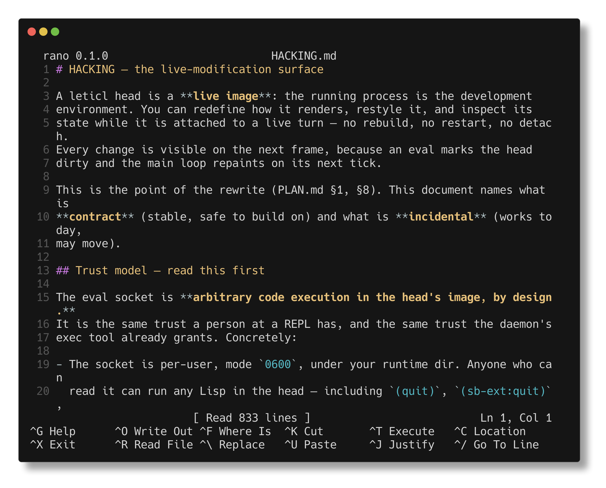

# rano

A nano clone for the terminal, in Rust. nano's keys and nano's immediacy, with tree-sitter
syntax highlighting, a minimal LSP client, and a tail that opens a 2 GiB log without reading
it. It is also a library, so a host can show the editor as a pane.



## Install

```sh
curl -fsSL https://raw.githubusercontent.com/deadtrickster/rano/master/install.sh | sh
```

Downloads the prebuilt binary from the
[latest release](https://github.com/deadtrickster/rano/releases/latest) into `~/.local/bin`:
Linux x86_64/aarch64 and macOS arm64/x86_64, no toolchain needed. Where there is no asset it
builds from source, which needs [Rust](https://rustup.rs) and a C compiler. The script is
[`install.sh`](install.sh), and its switches are in [configuration](docs/configuration.md).

With Rust already installed, `cargo install --git https://github.com/deadtrickster/rano.git`.
From a checkout:

```sh
cargo build --release
```

## Usage

```
rano [options] [file...]

  -l, --line N      cursor on line N (1-based), centred
  -c, --column N    cursor on column N (1-based)
  -f, --follow      open at the tail, and keep reading as the file grows
  --edit            open a .log as an ordinary file (a .log IS one by default)
                    (these apply to the first file)
  file:LINE[:COL]   open that file at that position (any file, not just the first)
  +LINE[,COL] file  the same, nano/vi style, for the file after it
  -h, --help        usage
  -V, --version     the version

  --export FORMAT [file]   colourise to stdout and exit (html, ansi, markdown, text)
```

Opens `file` if it exists, otherwise starts a new buffer that will be saved under that name.
No arguments starts an empty buffer. `--line` and `--column` make rano usable as somebody
else's `$EDITOR`: a compiler error or a grep hit gives you a line, centred so you see its
context. Several files open one buffer each: `rano src/*.rs`.

## Keys

`C-x` is Ctrl+x, `M-x` is Alt+x.

| Key | What it does |
|---|---|
| `C-o` / `F2` | Save |
| `C-x` | Exit |
| `C-g` / `F1` | Help prefix: `?` page, `k` describe a key, `b` all keys, `m` manual, `x` run a command |
| `M-x` | Run any command by name |
| `C-f` / `F3` | Search. `C-b` searches backwards |
| `C-k` / `C-u` | Cut / paste |
| `F8` | Open a file. `name:line[:col]` jumps there |
| `M-<` / `M->`, `M-l` | Previous / next buffer, buffer list |
| `M-p` | Preview a diff, a markdown file, a picture, or merge conflicts |

The rest are in [docs/keys.md](docs/keys.md). The bar and `C-g b` show what is in effect, and
`M-x` finds a command from a few letters.

## What it does

Tree-sitter highlighting for Rust, Go, Bash, Python, C, JSON, Common Lisp, JavaScript,
TypeScript, Markdown, TOML, YAML, HTML, CSS, Lua, Ruby, PHP, Java, Make, Dockerfile, INI,
diff, Elisp, Scheme, SQL and Clojure, by extension, conventional name or shebang. Syntax
errors show as diagnostics with no language server.

A language server on `$PATH`, in `~/.local/bin`, `~/.cargo/bin`, mise's shims or `~/go/bin`
starts in the background: diagnostics, completion, `M-.` definition, `M-?` usages.

A `.log` opens as a read-only tail that follows the file ([docs/logs.md](docs/logs.md)),
`TODO.md` checkboxes are live ([docs/keys.md](docs/keys.md)), and a `.wasm` plugin can
transform text on open and save ([docs/plugins.md](docs/plugins.md)).

## What it does not do

- It does not watch files. Saving over a file something else wrote since rano read it asks
  first, and `d` shows the difference.
- It does not give a plugin much: a hook imports nothing, and `read-dir` is the one capability.
- It carries no image decoder. Pictures need a terminal that takes inline images, and any
  format but PNG needs a converter on the machine.
- It ships no language server. With none installed you get tree-sitter feedback only.
- It has no GUI and no tabs.

## Docs

- [docs/keys.md](docs/keys.md) - every key, by mode.
- [docs/configuration.md](docs/configuration.md) - `config.toml`, themes, environment, updates.
- [docs/plugins.md](docs/plugins.md) - the wasm ABI, capabilities, the SDKs.
- [docs/embedding.md](docs/embedding.md) - the `Editor` API, sending the reader's place.
- [docs/logs.md](docs/logs.md) - what a `.log` does.

## Development

```sh
cargo test            # the slow rust-analyzer e2e is #[ignore]d
cargo test -- --ignored
cargo clippy --all-targets -- -D warnings
cargo fmt --all -- --check
```
